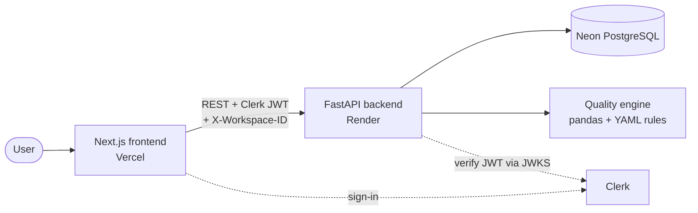
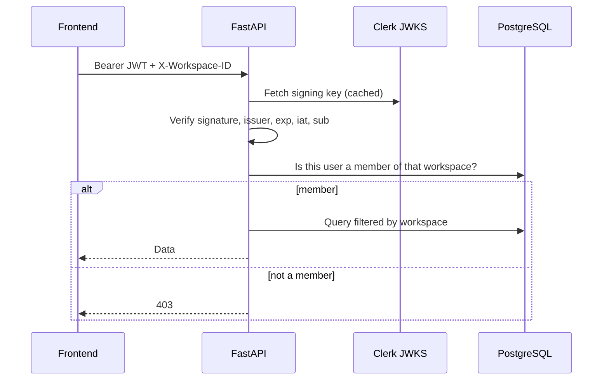
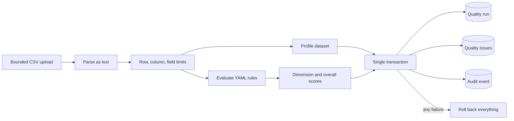
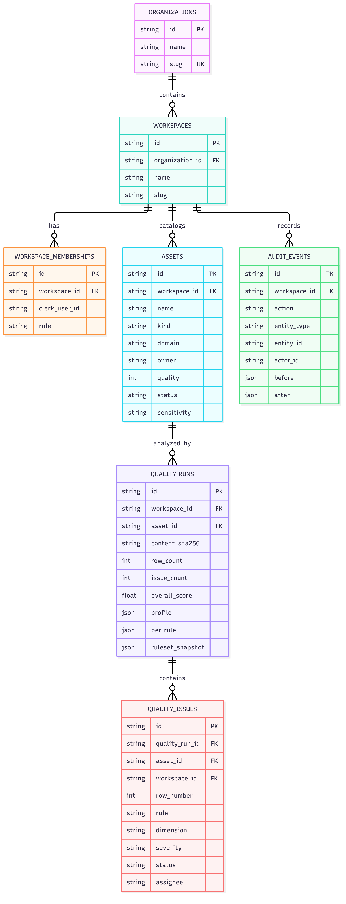
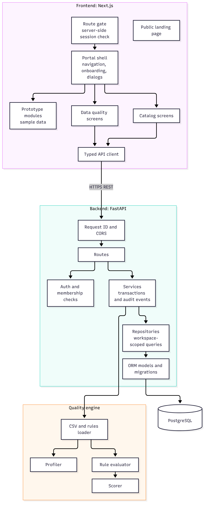

<p align="center"></p>

<h1 align="center">Datara Showcase</h1>
<p align="center"><b>Know your data. Govern with confidence.</b></p>


This repository explains **Datara**, a data governance platform I designed and built end to end: a Next.js portal, a FastAPI + PostgreSQL API, and a reusable pandas-based data-quality engine. It holds architecture diagrams, data-model and API documentation, design decisions, test evidence and a product tour. **No source code is included.**

It is a **documentation repository only**. It contains no application code, no build step and no running service. The application itself lives in two separate repositories.

## Datara at a glance

| | |
|---|---|
| Problem | Dataset definitions, ownership and quality results live in separate tools, so teams cannot easily trust or fix their data |
| Solution | One workspace to catalog assets, upload a CSV, score it against configurable rules, and track each failed check as an issue with an audit trail |
| My role | Sole designer and developer: frontend, backend, database schema, quality engine and deployment |
| Stack | Next.js 16, React 19, TypeScript, Clerk, FastAPI, SQLAlchemy, Alembic, PostgreSQL (Neon), pandas, Vercel, Render |

## Where everything lives

| Part | Link |
|---|---|
| Live application | [datara-platform.vercel.app](https://datara-platform.vercel.app) |
| Frontend repository | [datara-platform](https://github.com/shivansh-kumar-adi/datara-platform) |
| Backend repository | [datara-backend](https://github.com/shivansh-kumar-adi/datara-backend) |
| Production API | `https://datara-backend-gv91.onrender.com` |
| API health check | [`/api/v1/health`](https://datara-backend-gv91.onrender.com/api/v1/health) |
| Portfolio | [shivanshonline.in](https://shivanshonline.in) |

The health link is a live check you can run yourself; a past healthy response does not guarantee the service is up now.

## Contents

- [How the three projects relate](#how-the-three-projects-relate)
- [Architecture](#architecture)
- [What works today](#what-works-today)
- [Authentication and tenant isolation](#authentication-and-tenant-isolation)
- [Data-quality pipeline](#data-quality-pipeline)
- [Data model](#data-model)
- [API summary](#api-summary)
- [Engineering highlights](#engineering-highlights)
- [Testing evidence](#testing-evidence)
- [Diagrams](#diagrams)
- [Screenshots](#screenshots)
- [Documentation map](#documentation-map)
- [Repository structure](#repository-structure)
- [Validating this repository](#validating-this-repository)
- [Known limitations of Datara](#known-limitations-of-datara)
- [Roadmap](#roadmap)
- [Contributing](#contributing)
- [License](#license)

## How the three projects relate

| Project | What it is | Contains |
|---|---|---|
| **datara-showcase** (this repo) | Documentation and diagrams | Markdown, Mermaid, brand assets, two validation scripts |
| **datara-platform** | The web application | Next.js frontend, Clerk sign-in, typed API client |
| **datara-backend** | The API | FastAPI routes, services, database models, migrations, the quality engine |

This repository does not import, call or embed the other two. It only describes them and links to them.

## Architecture



- **Frontend** renders the public site and the portal and calls the API through one typed client.
- **Backend** verifies the Clerk token, checks workspace membership, runs services inside transactions and returns a consistent error format.
- **Quality engine** profiles a CSV and evaluates server-side YAML rules; it is independent of the web layer.
- **Database** is reached only by the backend.

More diagrams are in [docs/architecture](docs/architecture/) (system context, containers, request flow, quality pipeline, ERD, deployment, error handling, CI/CD and authentication).

## What works today

| Capability | Status |
|---|---|
| Public product website | Implemented |
| Sign in and sign up (Clerk) | Implemented |
| Workspace onboarding (organization, workspace, owner membership) | Implemented |
| Data catalog: list, search, domain filter, create, edit | Implemented, API-backed |
| CSV quality analysis with scores, profile and rule results | Implemented, persisted |
| Quality run history and issue filtering | Implemented |
| Issue workflow: status and assignee | Implemented |
| Audit events for mutations | Implemented |
| Overview, dictionary, glossary, lineage, policies, ownership, discovery, simulator, copilot, audit log, administration screens | Prototype: sample data, nothing saved |
| Role-based permissions | Planned (roles are stored, not yet enforced) |
| CI/CD | Not set up |

Status verified against the frontend and backend source on 2026-10-19.

## Authentication and tenant isolation



Two layers keep tenants apart:

1. **Application:** every repository query includes the workspace ID, and membership is checked before any workspace data is read.
2. **Database:** quality runs and issues reference their asset and workspace with composite foreign keys, so a cross-workspace link is rejected by PostgreSQL itself.

## Data-quality pipeline



Scores come from the actual uploaded values, across three dimensions (completeness, validity, uniqueness). The run, its issues and an audit event are saved together or not at all. The uploaded file is not stored, only its hash, size and filename.

## Data model



Seven tables, managed by four Alembic migrations, with opaque prefixed IDs, UTC timestamps, check constraints and indexes for workspace and time queries. Full column details are in the [backend README](https://github.com/shivansh-kumar-adi/datara-backend).

## API summary

Versioned REST under `/api/v1`: health, onboarding, assets (list, create, read, update), quality runs (upload, list, read), quality issues (list, update) and the usual cursor pagination. Errors share one envelope with a code, message, field errors and request ID. The full table is in the [backend README](https://github.com/shivansh-kumar-adi/datara-backend); this repository's [API notes](docs/08-api-reference.md) summarise it.

## Engineering highlights

- A framework-independent quality engine reused by the API and by a CLI and dashboard.
- Tenant safety enforced in the schema, not only in application code.
- Atomic persistence of a run, its issues and its audit event, with a rollback test.
- Bounded CSV handling: size, rows, columns, field length and issue count.
- Server-side-only rules: callers cannot supply their own ruleset.
- Honest UI: live screens show real errors and never fall back to fake data; prototype screens are labelled as such.
- A single typed API client in the frontend, with the backend's error format carried through to the UI.

More in [engineering highlights](showcase/engineering-highlights.md) and [design decisions](docs/18-decisions-and-tradeoffs.md).

## Testing evidence

Run on 2026-10-19 against the public repositories:

| Suite | Result |
|---|---|
| Backend (pytest, in-memory SQLite) | 21 passed |
| Frontend API client (Node test runner) | 5 passed |
| Frontend type check | Passed |

Tests do not yet cover PostgreSQL, real Clerk tokens, browser end-to-end flows or accessibility. No coverage figure is claimed. See [testing and QA](docs/13-testing-and-quality-assurance.md).

## Diagrams

Fifteen diagrams (architecture, flows, sequences, data model, deployment) have editable Mermaid sources in [docs/architecture](docs/architecture/) and rendered SVG and PNG images in [assets/diagrams](assets/diagrams/). Start with the [diagram guide](docs/architecture/README.md).



## Screenshots

No screenshots are committed yet. See the [capture guide](docs/22-demo-and-screenshots.md). Until they are added, the [product tour](showcase/product-tour.md) describes each screen, and the live application shows them.

## Documentation map

| Topic | Document |
|---|---|
| Product and scope | [Overview](docs/01-project-overview.md), [Problem](docs/02-problem-and-motivation.md), [Requirements](docs/03-requirements-and-scope.md) |
| Architecture | [System](docs/04-system-architecture.md), [Frontend](docs/05-frontend-architecture.md), [Backend](docs/06-backend-architecture.md), [Data flows](docs/11-data-flows.md), [Diagram guide](docs/architecture/README.md) |
| Data and API | [Database](docs/07-data-model-and-database.md), [API](docs/08-api-reference.md), [OpenAPI summary](docs/api/openapi.yaml) |
| Quality engine | [Engine](docs/10-data-quality-engine.md) |
| Security | [Authentication](docs/09-authentication-and-authorization.md), [Security and privacy](docs/12-security-and-privacy.md) |
| Engineering | [Testing](docs/13-testing-and-quality-assurance.md), [Deployment](docs/14-deployment-and-operations.md), [Performance](docs/15-performance-and-scalability.md), [Challenges](docs/16-challenges-and-solutions.md), [Decisions](docs/18-decisions-and-tradeoffs.md), [ADRs](docs/decisions/) |
| Status | [Known limitations](docs/19-known-limitations.md), [Future work](docs/20-future-enhancements.md), [Checklists](docs/checklists/) |
| Showcase | [At a glance](showcase/at-a-glance.md), [Product tour](showcase/product-tour.md), [Feature matrix](showcase/feature-matrix.md), [Sample scenarios](showcase/sample-scenarios.md), [Engineering highlights](showcase/engineering-highlights.md) |
| Planning | [Roadmap](ROADMAP.md), [Milestones](planning/milestone-plan.md), [Risks](planning/risk-register.md) |

## Repository structure

```text
datara-showcase/
├── README.md                  # this overview
├── docs/
│   ├── 01 ... 22 *.md         # numbered documentation set
│   ├── architecture/          # 15 Mermaid diagram sources and a guide
│   ├── api/openapi.yaml       # hand-written API summary
│   ├── checklists/            # implementation, testing, security, release status
│   └── decisions/             # nine ADRs and a template
├── showcase/                  # at a glance, product tour, feature matrix, scenarios, highlights
├── planning/                  # milestones, completed and remaining work, risks
├── assets/
│   ├── brand/                 # logo files and brand guide
│   ├── diagrams/              # rendered SVG and PNG diagrams
│   └── screenshots/           # empty; see capture guide
├── scripts/
│   ├── validate_showcase.py   # forbidden files and secret-pattern check
│   └── validate_links.py      # relative Markdown link check
├── BUILD_REPORT.md            # audit report
├── ROADMAP.md  CHANGELOG.md  SECURITY.md  CONTRIBUTING.md  CODE_OF_CONDUCT.md
├── CITATION.cff  NOTICE.md  LICENSE
└── .gitignore
```

## Validating this repository

There is nothing to install or build. Python 3.11+ runs the two standard-library scripts.

Run `python scripts/validate_showcase.py` (no secrets, environment files or forbidden folders) and `python scripts/validate_links.py` (every relative Markdown link resolves).

Both pass on the current contents. The `.mmd` sources in `docs/architecture/` render on GitHub and in any Mermaid editor; the images in `assets/diagrams/` are ready to use.

## Known limitations of Datara

- Roles are stored on memberships but not enforced; every workspace member has the same access.
- JWT audience and authorized-party claims are not validated.
- Quality issues store the offending cell value, so uploaded data should be treated as sensitive.
- Only the catalog and quality screens are API-backed; the other 11 portal screens are prototypes.
- CSV analysis is synchronous and in memory.
- No CI/CD, structured logging or metrics yet.
- Tests run on SQLite, not PostgreSQL.

## Roadmap

Planned, not implemented: role enforcement, evidence redaction by default, per-workspace rulesets, background processing for large files, PostgreSQL-backed tests with CI, structured logging and metrics, and more API-backed governance modules. See [ROADMAP.md](ROADMAP.md).

## Contributing

Corrections to the documentation are welcome. Open an issue first, keep claims traceable to code or tests, never include source code, secrets or real data, and run both validation scripts before submitting. See [CONTRIBUTING.md](CONTRIBUTING.md). Security concerns follow [SECURITY.md](SECURITY.md).

## License

The documentation, diagrams, scripts and brand assets in this repository are licensed under **CC BY-NC-ND 4.0** (see [LICENSE](LICENSE)): you may share them unchanged, with credit, for non-commercial purposes. This does not license the application source code, which lives in separate repositories under their own terms. See [NOTICE.md](NOTICE.md).

## Developer

**Shivansh Kumar** · [Portfolio](https://shivanshonline.in) · [GitHub](https://github.com/shivansh-kumar-adi) · [LinkedIn](https://www.linkedin.com/in/shivansh-kumar-adi)
