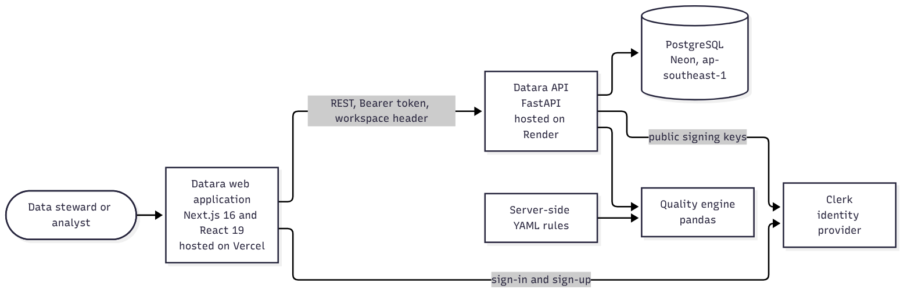

# System architecture

Datara is a three-part system: a browser application, an API and a database, with a separately reusable analysis engine and an external identity provider.

## Components

| Component | Responsibility | Technology | Hosting |
| --- | --- | --- | --- |
| Web application | Public site, sign-in pages, governance portal | Next.js 16, React 19, TypeScript | Vercel |
| Identity provider | Sign-up, sign-in and session tokens | Clerk | Clerk cloud |
| API | Authentication, authorization, validation, use cases, error format | FastAPI, Pydantic, SQLAlchemy | Render |
| Database | Organizations, workspaces, memberships, assets, runs, issues, audit events | PostgreSQL | Neon, ap-southeast-1 |
| Quality engine | Parse, profile, evaluate rules, score | pandas with YAML rules | Inside the API process |

## Layers inside the API

1. **Middleware** assigns a request ID, applies CORS and returns the ID in a response header.
2. **Routes** handle HTTP concerns: parsing, validation and response models.
3. **Dependencies** verify the token and check workspace membership before a route runs.
4. **Services** orchestrate a use case, own the transaction and write the audit event.
5. **Repositories** build workspace-scoped queries and cursor pagination.
6. **Models** map tables and declare constraints and indexes.

Keeping these layers separate means validation, business flow and data access can each be tested and changed on their own.

## Trust boundaries

- The browser is untrusted. Everything it sends is validated.
- The token is trusted only after signature, issuer and expiry checks against Clerk's public keys.
- The workspace header is treated as a request to use a workspace, and is honoured only when the caller is a member of it.
- Quality rules come from a server-side file and cannot be supplied by a caller.
- The database is reachable only from the API.

## Failure behaviour

Failures are explicit. Parser, size and rule problems return structured 4xx errors and save nothing. A database or audit failure rolls back the whole transaction. The frontend shows the backend's message and offers a retry, and it never falls back to sample data on live screens. See [error handling](architecture/error-handling-flow.mmd) and [data flows](11-data-flows.md).

## Deployment shape

Two services and one database, configured through environment variables. See [deployment and operations](14-deployment-and-operations.md).

## Why this shape

A single deployable API keeps the project understandable and cheap to run. The engine is a separate module so it can be tested without a web server and reused by a command-line tool. Clerk avoids writing password and session handling by hand, while authorization stays in Datara's own database. These choices are recorded in the [ADRs](decisions/).
