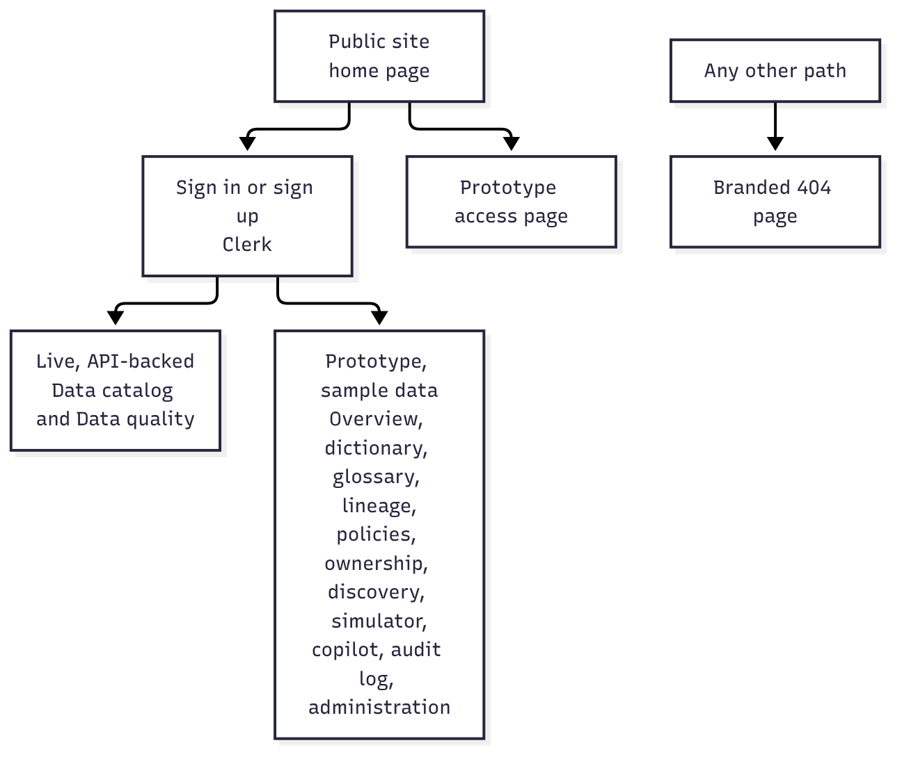

# Frontend architecture

The frontend is a Next.js 16 App Router application written in TypeScript with React 19. Styling is a single plain CSS file; icons come from lucide-react. There is no Redux, Axios, form library, charting library or UI kit.

## Routes

| Route | Experience | Status |
| --- | --- | --- |
| Home | Public product website | Implemented |
| Sign-in and sign-up | Clerk-hosted forms inside branded pages | Implemented |
| Access | Explains the prototype modules | Implemented |
| Catalog | Search, filter, paginate, view, create and edit assets | Live, API-backed |
| Data quality | Upload CSV, scores, profile, rules, run history, issue workflow | Live, API-backed |
| Overview, dictionary, glossary, lineage, policies, ownership, discovery, simulator, copilot, audit, admin | Product-direction screens | Prototype, sample data |

A single catch-all route accepts exactly one path segment. For the 13 portal routes it checks the Clerk session on the server and redirects to sign-in when there is none. Any other path returns a branded 404. Clerk's middleware also runs on page requests.

## Component structure

- **Landing page:** the public marketing site with interactive feature tabs and a simulated demonstration.
- **Portal shell:** sidebar navigation, search, page header, dialogs and a toast. It also performs workspace bootstrap and shows the onboarding form for new users.
- **Catalog screens:** list, detail dialog and the create or edit form, with per-field validation messages from the API.
- **Data quality screens:** upload form, history list, score cards, profile, rule results and the issue table.
- **Prototype modules:** read sample data and keep interactions in browser memory only.

## State management

State is local React state; there is no global store.

- **Server data** is fetched per panel with loading, error and "cancelled" flags so a slow response cannot overwrite a newer selection.
- **Pagination** keeps a history of cursors so the Previous button works.
- **Forms** are controlled inputs; server field errors are shown under the matching field.
- **Auth** comes from Clerk's hooks; a token provider is registered with the API client.
- **Active workspace** is stored in the API client after the onboarding lookup.
- The application does not use browser storage itself.

## API client

All backend calls live in one typed module. It builds the URL from a public environment variable, attaches the Bearer token and the workspace header, sends multipart data for uploads, and converts the backend's error format into a single error type carrying the status, code, field errors and request ID. If the base URL is missing it fails with a clear configuration message before making a request.

## Workspace bootstrap

After sign-in the portal asks the API for the user's workspace. If none exists it shows a short form to create an organization and a workspace; otherwise it uses the existing one. Every later request carries that workspace ID.

## Error, loading and empty states

Every live screen has all four states: loading, empty, error with retry, and success. Error text is the backend's message, so users see specific reasons such as a CSV not matching the rules.

## Testing

Five automated tests cover the API client: workspace headers and filters, error format, missing configuration, quality query building and multipart upload. There are no component or end-to-end tests yet.

## Known frontend limitations

The portal header shows a fixed sample workspace name, the 11 prototype modules are not API-backed, styling is one large file, and responsiveness and accessibility have not been formally assessed. See [known limitations](19-known-limitations.md).
