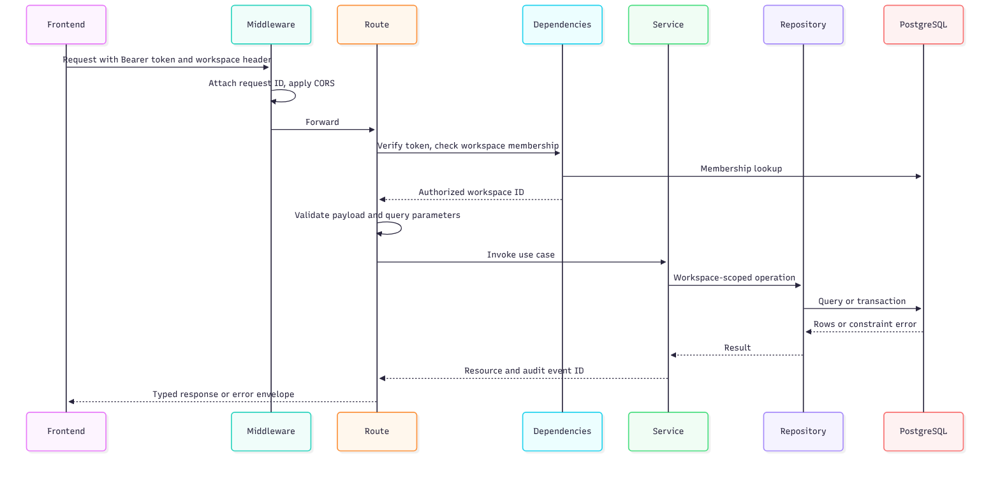

# Backend architecture

The backend is a FastAPI application with Pydantic validation, SQLAlchemy 2 for persistence, Alembic for migrations and PostgreSQL as the database. It exposes a versioned REST API under a single prefix.

## Application setup

- An application factory builds the app, adds CORS, a request-ID middleware and three error handlers.
- **CORS** allows only configured origins, the methods GET, POST, PATCH and OPTIONS, and the headers Authorization, Content-Type, X-Workspace-ID and X-Request-ID.
- **Request IDs** are taken from the incoming header when present or generated, and are returned on every response.
- **Settings** are read from environment variables with a common prefix, including the database URL, allowed origins, Clerk issuer and key URL, and the upload limits.
- **Documentation** uses FastAPI's default Swagger UI and ReDoc paths.

## Layers

| Layer | Purpose |
| --- | --- |
| Routes | Declare endpoints, validate input, shape responses |
| Dependencies | Provide a database session, the authenticated user and the verified workspace |
| Services | Create or update resources, run quality analysis, write audit events, commit or roll back |
| Repositories | Run workspace-filtered queries and cursor pagination |
| Models | Tables, relationships, check constraints and indexes |
| Schemas | Request and response contracts, including enumerations for asset fields |

## Endpoints

Health, onboarding (read and create), assets (list, read, create, update), quality runs (upload, list, read), run issues (list) and issue update. The complete table is in the [API reference](08-api-reference.md).

## Transactions

Each use case that changes data commits once. Asset create and update write the asset and an audit event together. A quality run writes the run, all issues and the audit event together. Onboarding writes the organization, workspace and owner membership together. Any exception rolls the transaction back, and database constraint conflicts become a clear 409 response.

## Pagination

Lists use cursor pagination ordered by creation time and identifier. The response carries the items, a cursor for the next page and the total count. An invalid cursor returns a 422.

## Error format

Every error uses one envelope with a stable code, a human-readable message, field errors where relevant and the request ID. Unknown routes return the same envelope with a route-not-found code. Authentication failures use FastAPI's standard detail response.

## Quality engine integration

The route reads the upload in chunks and stops at the size limit. The service decodes UTF-8, parses with pandas, applies row, column and field limits, loads the trusted ruleset, analyses the data and checks the issue count. Only then does it open the transaction. See [quality engine](10-data-quality-engine.md).

## Testing

Twenty-one tests cover health, assets, onboarding, quality uploads, pagination, workspace scoping, rollback and database constraints. They run on an in-memory SQLite database with the authentication dependency overridden, so they need no external service.

## Operational notes

Requests carry correlation IDs and the health endpoint reports database availability separately from the API. There is no structured logging, metrics or rate limiting yet.
