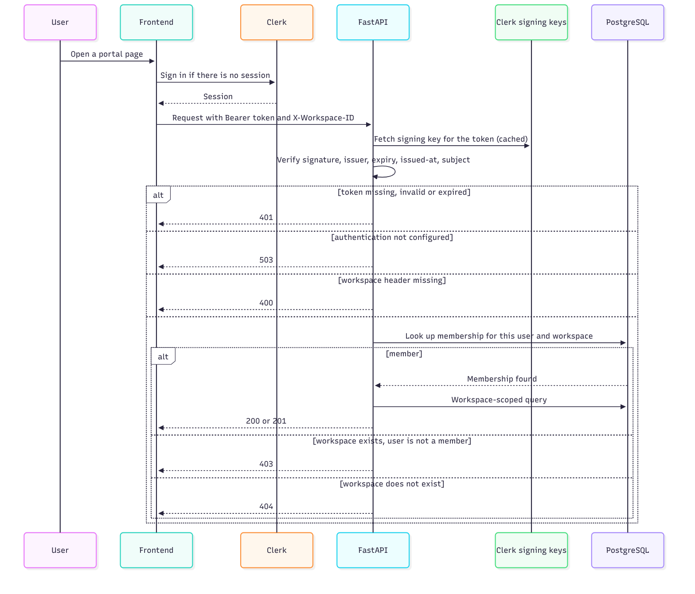

# Authentication and authorization

Datara separates **who you are** (authentication, handled with Clerk) from **what you may access** (authorization, handled by Datara's own database).

## Authentication

1. The frontend uses Clerk for sign-up and sign-in. Portal routes are protected on the server, so a signed-out visitor is redirected to sign-in.
2. For each API call the frontend obtains a short-lived session token and sends it as a Bearer token.
3. The API fetches Clerk's public signing keys (and caches them) and verifies the token's signature, issuer, expiry, issued-at time and subject. The signing algorithm is RS256.
4. The token's subject becomes the user identifier used everywhere else.
5. If the issuer or key location is not configured, the API answers 503 instead of silently accepting requests.

## Authorization

- The caller names a workspace in the `X-Workspace-ID` header.
- The API looks for a membership row for that user and workspace.
- Not a member of an existing workspace: 403. Unknown workspace: 404. Header missing: 400.
- Only after this check do repositories run, and they filter every query by the workspace.

The header is a selector, never proof of access. Guessing a workspace ID gets an attacker a 403.

## Onboarding and ownership

A new user has no membership. The portal calls the onboarding endpoint, which creates an organization, a workspace and an **owner** membership in one transaction. Calling it again returns the existing workspace, so it is safe to repeat.

## Roles

Memberships carry a role (owner at onboarding, member by default). **Role-based permissions are not enforced yet.** Today every member can read and change everything in the workspace. Planned roles are viewer, steward and administrator.

## Audit actor

Audit events record an actor for issue updates. Asset changes and quality-run events are currently recorded without a user identifier. Recording the actor everywhere is a planned improvement.

## What is verified

Tests confirm that requests without a token are rejected, that onboarding is repeatable, and that queries are scoped to the workspace. They override the token check, so real Clerk tokens are not exercised in the automated suite.

## Known gaps

- No role enforcement.
- The token audience and authorized-party claims are not checked.
- Authentication failures are logged with a plain print statement.
- No rate limiting.
- No automated test with a real token, wrong-origin token or expired token.

## Why Clerk

Writing password storage, email verification and session handling by hand is a common source of vulnerabilities. Clerk handles that, and the free plan is enough for this project. Keeping authorization in Datara's own tables avoids depending on paid role features and keeps the tenant model under my control. See [ADR-003](decisions/ADR-003-clerk-authentication-local-authorization.md).
