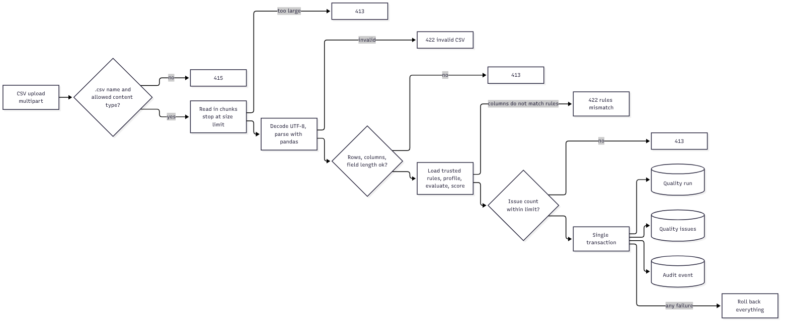

# Data quality engine

The engine is the part of Datara that turns a CSV into scores and issues. It is independent of FastAPI and the database: it receives a table and a ruleset and returns results. The same engine also backs a standalone command-line tool and dashboard I built earlier.

## What it does

1. **Loads** the CSV with pandas, treating values as text so nothing is silently converted.
2. **Profiles** the data: row and column counts, inferred type per column, null counts and percentages, distinct values, duplicate rows and numeric summaries.
3. **Evaluates rules** from a YAML configuration and records, for each rule, how many values were checked and how many failed.
4. **Generates issues** for each failure, with the row number, column, rule, dimension, severity and message.
5. **Scores** each dimension and combines them into an overall score using configurable weights.

## Rule types

| Dimension | Rule type | What it checks |
| --- | --- | --- |
| Completeness | Required | Listed columns must not be empty |
| Validity | Pattern | Value must match a regular expression |
| Validity | Date format | Value must parse in a given format |
| Validity | Not in the future | Dates must not be later than today |
| Validity | Range | Numbers must fall between a minimum and a maximum |
| Validity | Allowed values | Value must be in a fixed list |
| Uniqueness | Unique key | A column must have no repeated values |
| Uniqueness | Exact duplicates | Whole rows must not repeat |

Every rule has a name, a severity (high, medium or low) and an optional message. Adding or changing a rule needs no code change.

## The bundled ruleset

The ruleset that ships with the backend is a sample for customer-style data: it expects columns such as name, email, signup date, phone, age, country and customer ID. A CSV that does not contain the columns a rule needs is rejected with a clear "rules mismatch" message rather than scored incorrectly.

## How the API uses it

Before the engine runs, the API limits the upload size, row count, column count and field length. After it runs, the API checks the issue count against its limit. The rules file is trusted server configuration loaded with a safe loader; callers cannot upload their own rules. The run keeps a snapshot of the ruleset so results stay explainable later.

## Properties worth noting

- Scores are computed from the real file, never from asset metadata.
- A dimension with no applicable rules has no score and is left out of the overall score.
- The engine does not touch the database, so it is easy to test.
- Results are deterministic for the same file and ruleset.

## Limitations

- One ruleset for the whole server; per-asset rules are planned.
- The whole file is loaded into memory and analysed inside the request.
- Issue evidence includes the offending cell value, and the profile includes example values. Both can expose sensitive data and are planned to be redacted by default.
- Only CSV files are supported.

See also [data flows](11-data-flows.md) and [performance](15-performance-and-scalability.md).
