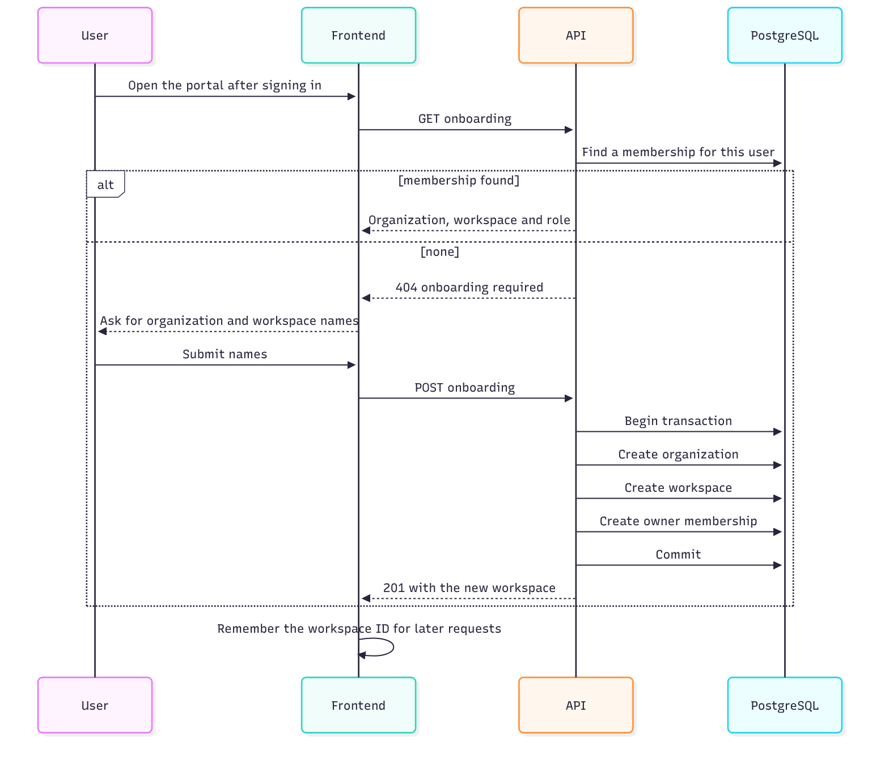
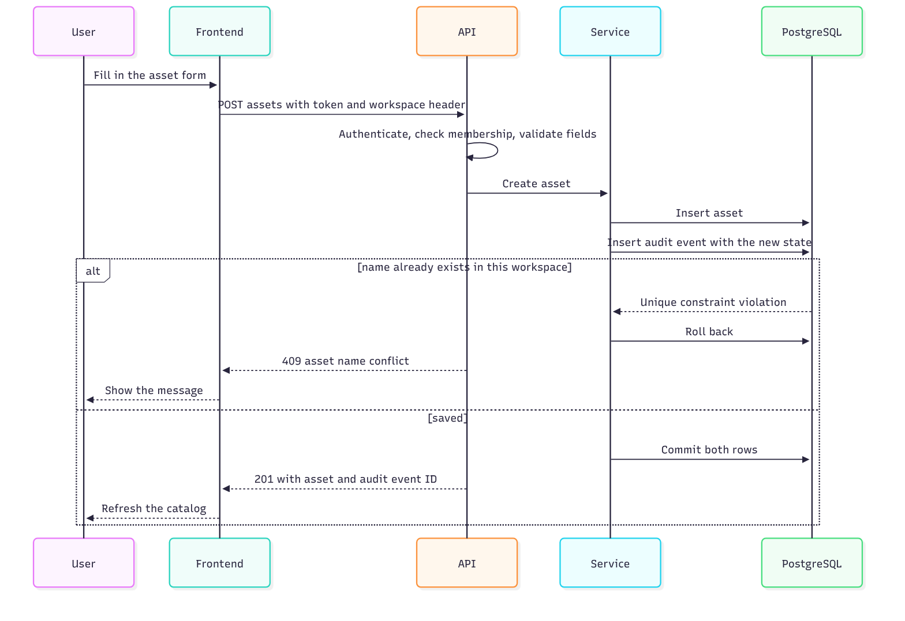
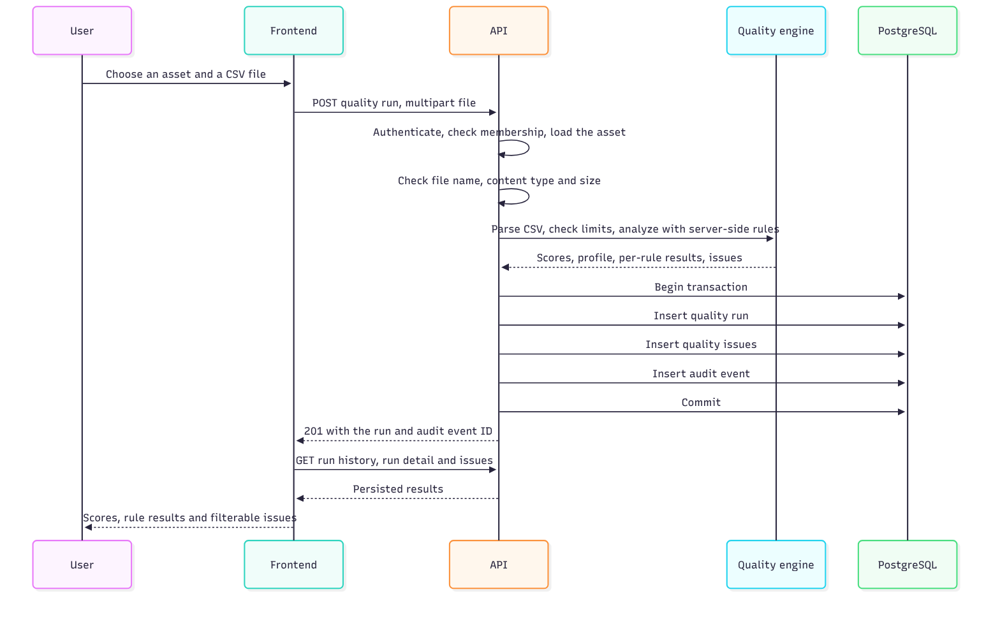
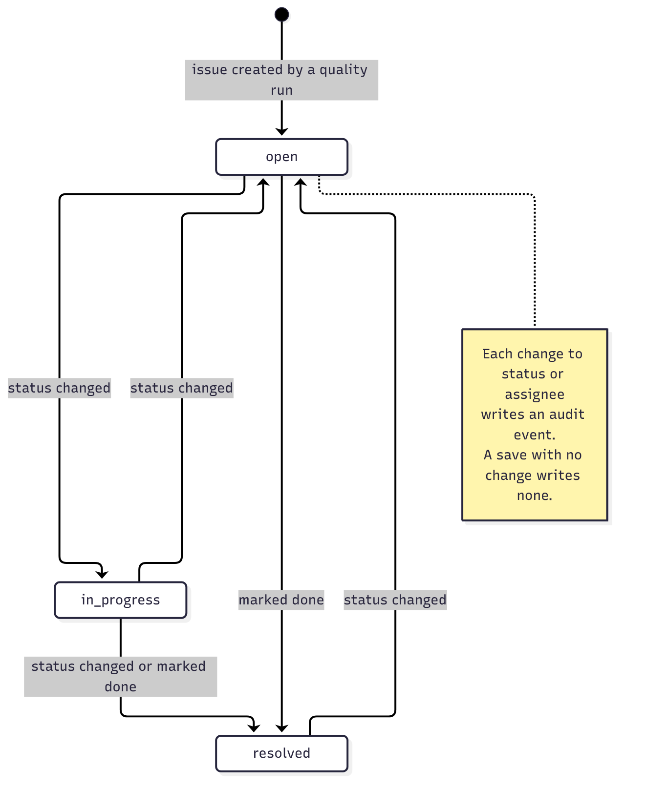
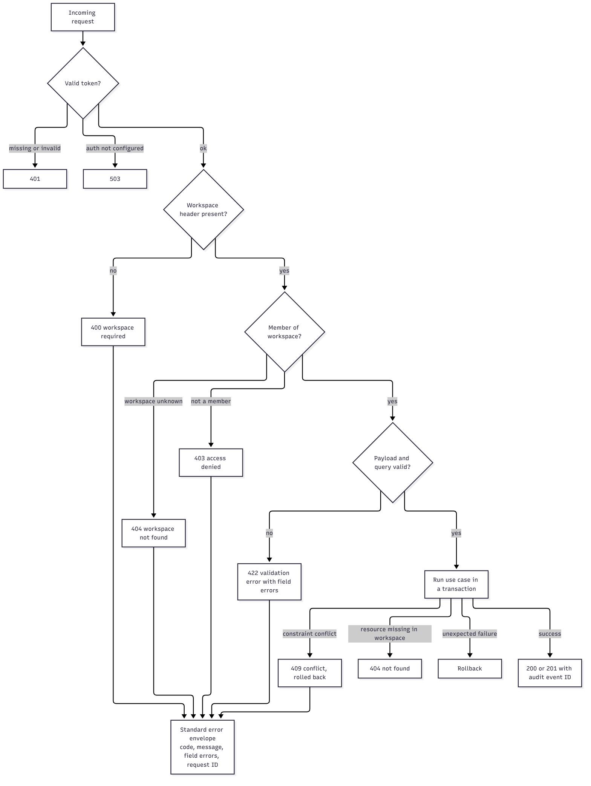

# Data flows

This page follows data through the system for each main workflow. Diagrams are in `assets/diagrams/`.

## 1. Sign-in and workspace bootstrap

The user signs in with Clerk. The portal asks the API for the user's workspace. A new user gets a short form; submitting it creates an organization, a workspace and an owner membership in one transaction. The workspace ID is then attached to every request.

## 2. Reading the catalog

The browser sends the search text, domain and cursor, the Bearer token and the workspace header. The API verifies the token, checks membership, and runs a repository query that adds the workspace before the search, domain and cursor conditions. The response contains up to 100 items, the next cursor and the total. Search is debounced in the browser and any change to search or domain resets pagination.

## 3. Creating or editing an asset

The form is validated by the API. The service saves the asset and an audit event in one transaction. A duplicate name inside the workspace violates a unique constraint, the transaction rolls back and the user sees a clear 409 message under the form.

## 4. Running a quality check

1. The user picks an asset and a CSV.
2. The API loads the asset inside the workspace, checks the file name and content type, and reads the file in chunks up to the size limit.
3. The engine parses, checks limits, loads the server's rules, profiles and scores.
4. The service saves the run, its issues and an audit event in one transaction.
5. The frontend selects the new run and refreshes the history.

The uploaded file is never stored; only its hash, size and name are.

## 5. Reviewing results

Four panels load independently: the asset list, the run history for the chosen asset, the selected run's scores, profile and rule results, and the issues for that run. Issue filters (dimension and severity) and cursor pagination are applied by the API.

## 6. Working an issue

The user changes the status or assignee and saves, or clicks Mark as done. The API compares the new values with the old ones. If something changed it saves the issue and an audit event that includes the acting user; if nothing changed it returns the issue without writing an event.

## Failure paths

| Situation | Result |
| --- | --- |
| API address not configured in the frontend | A configuration message; no request is sent |
| API unreachable | An unavailable message with a retry button |
| Missing or expired token | 401 |
| Not a member of the workspace | 403 |
| Oversized, invalid or unsupported CSV | A 4xx response with a specific code; nothing is saved |
| CSV columns do not match the rules | 422 rules mismatch; nothing is saved |
| Database or audit failure | Whole transaction rolled back |

