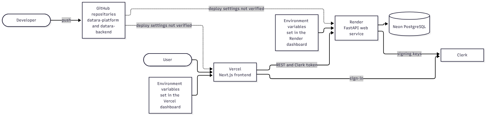

# Deployment and operations

## Topology

| Part | Host | Notes |
| --- | --- | --- |
| Frontend | Vercel | Next.js application at datara-platform.vercel.app |
| API | Render | Web service at datara-backend-gv91.onrender.com |
| Database | Neon | PostgreSQL in ap-southeast-1, reached only by the API |
| Identity | Clerk | Used by the browser for sign-in and by the API for signing keys |

The frontend never connects to the database. It calls the API over HTTPS.

## Configuration

All configuration is through environment variables set in each host's dashboard. No secrets are committed.

- **Frontend:** the API address, the Clerk publishable key and the Clerk server key. The first two are visible in the browser bundle and are not secret; the server key is private.
- **Backend:** the database URL, the allowed origins, the Clerk issuer and key location, an environment label, and optional limits for uploads and a rules file location.

The production API must list the frontend's address among its allowed origins, otherwise browsers will block the calls.

## Database

The production database has been migrated to the latest revision (`23c8f45db16d`) and contains the seven tables. Migrations are applied by hand with Alembic, reading the same database URL as the application. Destructive operations are never run against production.

## Health

The API exposes a health endpoint at `/api/v1/health`. It returns 200 with healthy statuses when both the API and database are reachable, and 503 when the database is not. It is a live check anyone can run. A past healthy result is not a promise about now.

Free hosting tiers may pause idle services, so the first request after a quiet period can be slow.

## Release process (today)

1. Run the tests locally.
2. Push to GitHub.
3. Apply any new migration to the production database by hand, before the new API version starts using it.
4. Confirm the health endpoint and try a sign-in and a catalog request.

Whether a push triggers an automatic deployment depends on settings in Vercel and Render that I have not documented here.

## Gaps

- No CI/CD pipeline.
- No metrics, tracing or alerting; only request IDs and the health endpoint.
- No documented backup and restore exercise (relies on the database provider's features).
- No rollback runbook.
- The frontend build script is written for Windows and needs a cross-platform replacement.

The proposed pipeline is shown in the [CI/CD diagram](architecture/ci-cd-flow.mmd); it is a proposal, not something that exists.
